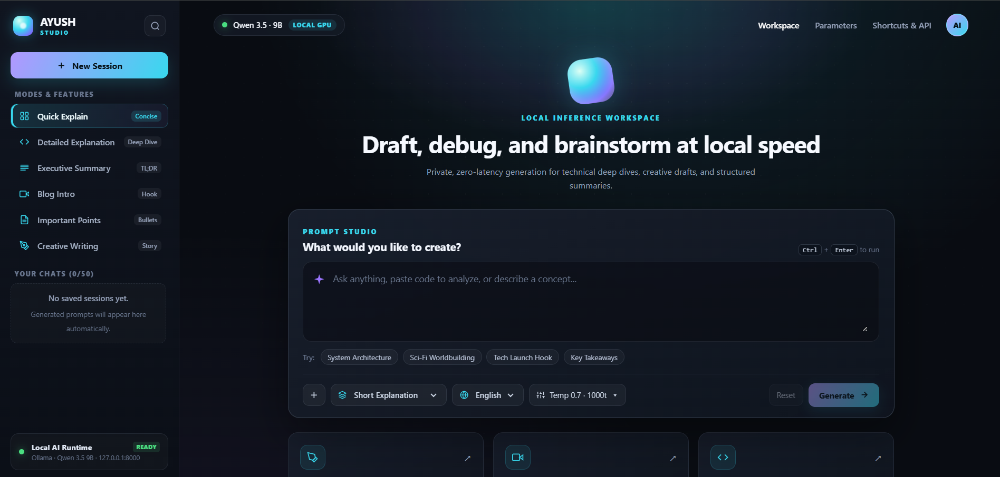
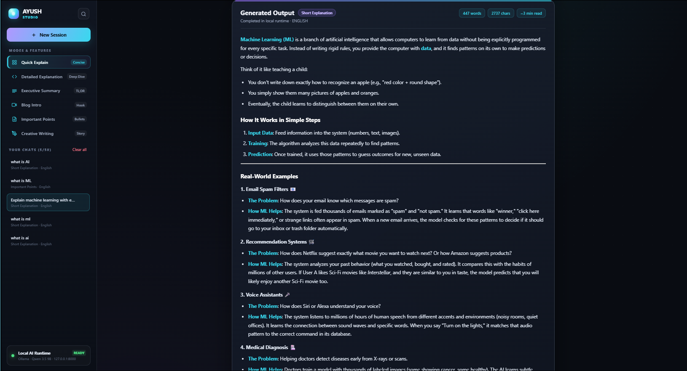
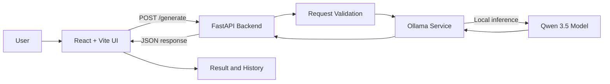
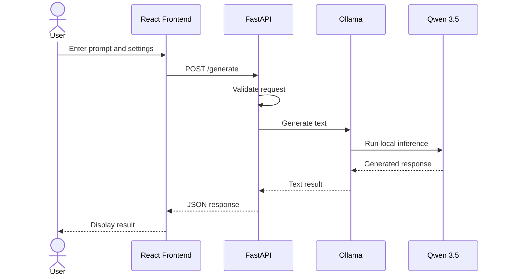

<div align="center">

# ✦ AI TEXT GENERATOR
### Local AI Text Generation, running on your machine.

A focused AI writing workspace built with **React**, **FastAPI**, **Ollama**, and **Qwen 3.5**.


**[Features](#-features) · [Architecture](#-how-it-works) · [Setup](#-getting-started) · [API](#-api-reference)**

</div>

---

## Overview

**Syntrix** is a locally run AI text-generation web application. Enter a prompt, choose a content format and language, adjust generation settings, and receive an AI-generated response through a React interface.

The backend uses **FastAPI** and sends generation requests to a local **Ollama** runtime. The current model configuration is `qwen3.5:latest`.

> **Local-first:** Syntrix is designed to run on your own computer. Ollama and the selected model must be installed locally.

## ✨ Features

| Feature | Description |
|---|---|
| AI text generation | Generate content from a user-provided prompt. |
| Content formats | Short explanation, detailed explanation, summary, blog introduction, important points, and creative writing. |
| Language selection | English, Hindi, and Hinglish. |
| Generation controls | Adjust temperature and maximum output tokens. |
| Generation history | Save recent generations in browser local storage and restore previous results. |
| History management | Search, restore, and delete saved entries. |
| Markdown output | Display formatted generated responses. |
| Copy and download | Copy generated text or download it as a TXT file. |
| Usage statistics | View generated word and character counts. |
| Error handling | Show feedback when the API or local Ollama service is unavailable. |

## 🖥️ Interface

Add screenshots of your running application to `docs/images/` and then embed them here.

| Main workspace | Generated response |
|---|---|
| `docs/images/syntrix-workspace.png` | `docs/images/syntrix-result.png` |

After adding the images, replace this table with:

```md


```

## 🧩 How It Works

The frontend collects the prompt and generation settings. FastAPI validates the request and calls the Ollama service. Ollama runs the local Qwen model and returns generated text to the backend, which sends the response to the React interface.



### Request lifecycle



## 🛠️ Technology Stack

| Layer | Technology | Responsibility |
|---|---|---|
| Frontend | React 19 | User interface and application state |
| Frontend tooling | Vite | Development server and build tooling |
| Backend | Python 3.13 + FastAPI | REST API and request validation |
| AI runtime | Ollama | Local model execution |
| Language model | Qwen 3.5 | Text generation |
| Validation | Pydantic | Validate generation inputs |
| Browser storage | localStorage | Persist generation history locally |

## 🚀 Getting Started

### Prerequisites

Install Python 3.13, Node.js and npm, Git, and Ollama.

Pull the model used by the backend:

```bash
ollama pull qwen3.5:latest
```

Make sure Ollama is running before generating text.

### 1. Clone the repository

```bash
git clone https://github.com/ayushgautamcodes/ai-text-generator.git
cd ai-text-generator
```

### 2. Set up the backend

Run these commands from the project root:

```powershell
cd backend
py -3.13 -m venv .venv
.venv\Scripts\Activate.ps1
python -m pip install --upgrade pip
pip install -r requirements.txt
```

Start the API from the **backend** directory:

```bash
uvicorn app.main:app --reload
```

Backend addresses:

- API root: http://127.0.0.1:8000/
- Interactive API documentation: http://127.0.0.1:8000/docs

### 3. Set up the frontend

Open a **second terminal** at the project root:

```powershell
cd frontend
npm install
npm run dev
```

Open the Vite URL shown in the terminal (normally http://localhost:5173/).

Keep the backend, frontend, and Ollama service running while using the application.

## 🔌 API Reference

### Generate text

**Endpoint:** `POST /generate`

Example request:

```json
{
  "prompt": "Explain machine learning to a beginner.",
  "content_type": "detailed_explanation",
  "language": "english",
  "temperature": 0.7,
  "max_tokens": 1000
}
```

Example response:

```json
{
  "message": "Text generated successfully",
  "prompt": "Explain machine learning to a beginner.",
  "generated_text": "Machine learning is a field of artificial intelligence...",
  "status": "success"
}
```

Validation rules:

- Prompt: 3–2000 characters after whitespace is trimmed.
- Temperature: `0.0`–`1.5`.
- Maximum output tokens: `100`–`2000`.

| Method | Route | Purpose |
|---|---|---|
| GET | `/` | Check whether the API is running |
| GET | `/docs` | Interactive Swagger documentation |
| POST | `/generate` | Generate text |

## 📁 Project Structure

```text
ai-text-generator/
├── backend/
│   ├── app/
│   │   ├── services/
│   │   │   └── ollama_service.py
│   │   └── main.py
│   ├── schemas/
│   │   └── generation.py
│   └── requirements.txt
│
├── frontend/
│   ├── src/
│   │   ├── App.jsx
│   │   └── App.css
│   ├── package.json
│   └── ...
│
├── .gitignore
└── README.md
```

*This tree highlights the main application files; supporting configuration files are omitted for readability.*

## ⚙️ Configuration Notes

- The backend currently uses the local model name `qwen3.5:latest`.
- The backend allows the frontend development origin `http://localhost:5173`.
- Generation history is stored in browser local storage. Clearing browser site data can remove it.
- Generation speed depends on your hardware and local model configuration.

## 🔒 Privacy and Deployment

Syntrix is currently configured for local development. The frontend calls a backend at `127.0.0.1:8000`, and the backend calls a local Ollama instance. Deploying only the frontend will **not** make text generation available to other users.

A public deployment requires a reachable and appropriately secured backend and model runtime. Do not expose Ollama or an unauthenticated generation endpoint directly to the public internet.

## 🗺️ Roadmap

- [ ] Add application screenshots and a short demo
- [ ] Add automated backend and frontend tests
- [ ] Add persistent server-side user history
- [ ] Add authentication and per-user settings
- [ ] Improve deployment configuration and API security
- [ ] Add support for selecting between multiple local models

## 🤝 Contributing

Suggestions and improvements are welcome. Open an issue to discuss a bug or feature, or submit a pull request with a clear description of the change.

## 👨‍💻 Author

**Ayush Pratap Gautam**

- GitHub: [@ayushgautamcodes](https://github.com/ayushgautamcodes)
- Repository: [ai-text-generator](https://github.com/ayushgautamcodes/ai-text-generator)

---

<div align="center">

**Built to explore full-stack development and local AI integration.**

</div>
